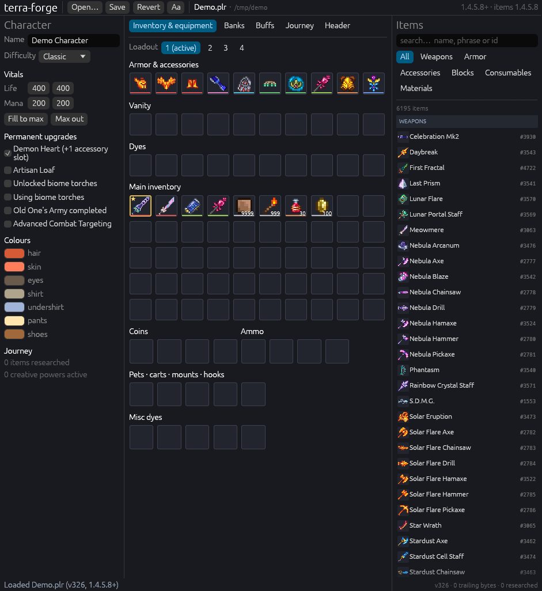

# terra-forge

A native Linux editor for **Terraria character files** (`.plr`) — written in Rust, drawn with
`egui`. Edit your character's stats, inventory, equipment, banks and Journey-mode research
without the game running.



Terraria's own character files are encrypted and versioned; most editors are web toys or
Windows-only. This one is a real desktop app, opens the modern format (1.4.4.9 and
1.4.5.x), and is built around a single rule: **it will not write a file it cannot prove it
can reproduce byte for byte.**

## Features

* **Inventory & equipment** — 10×5 backpack, coins and ammo, the five misc slots (pet,
  light pet, minecart, mount, hook) and their dyes, plus all four equipment loadouts.
* **Banks** — piggy bank, safe, Defender's forge and void vault, 40 slots each.
* **Drag and drop** — pick an item up in one slot and drop it in another to swap; drag an
  item out of the browser onto a slot to add it. Right-click gives a menu (max stack,
  favourite, duplicate, clear), the mouse wheel adjusts stacks, middle-click duplicates.
* **Real item artwork** — sprites are decoded from your own game files, so slots show the
  actual Terraria art. Without an installed game (or with the toggle off) you get
  rarity-coloured tiles instead.
* **Item browser** — 6,196 items with names, ids, rarity, stack limits and tooltips.
  Grouped into sections (weapons, armor, accessories, blocks, …) and subdivided by damage
  class or slot; typing switches to fuzzy search.
* **Character sheet** — name, difficulty, life/mana, permanent upgrades, hair and seven
  colours.
* **Journey mode** — read your research progress; buffs are editable slot by slot.
* **Adjustable UI** — zoom 0.8–2.0 and slot size, remembered between runs.
* **Backups** — every save first copies the old file to `<name>.plr.bak`.

## Safety model

A `.plr` is AES-128-CBC over a versioned binary stream. Terraria appends fields as it
patches, so a naive parser silently eats the wrong bytes on a new game version.

Three things keep that from happening here:

1. **Round-trip proof.** Because the cipher uses a fixed IV, `decrypt → parse → serialize →
   encrypt` must be byte-identical. `terra-core` checks this before every write and refuses
   to save otherwise.
2. **Unknown bytes are preserved.** Anything after the last field the parser understands is
   kept verbatim and written back, so a field added in a future patch survives untouched.
3. **Backups.** The original file is copied to `<name>.plr.bak` first, and the new file is
   written to a temporary path, decrypted and compared before it replaces anything.

Supported: 1.4.4.x (format 269–279) and 1.4.5.x (315–326). Pre-1.4 saves (format ≤ 194) are
rejected with a clear message rather than guessed at.

**Close Terraria (and Steam, if the character is a Steam Cloud save) before saving.** The
game and the editor both write the same file; whoever writes last wins.

## Build

Needs Rust 1.85+ and a normal Linux desktop with Vulkan or OpenGL drivers.

```sh
git clone https://github.com/mg4466/terra-forge
cd terra-forge
cargo build --release
./target/release/terra-forge
```

Or install it:

```sh
cargo install --path crates/terra-gui     # puts `terra-forge` in ~/.cargo/bin
```

Character files are found automatically in:

* `~/.local/share/Terraria/Players/`
* Steam Cloud: `~/.local/share/Steam/userdata/<account>/105600/remote/players/`
* tModLoader: `~/.local/share/Terraria/tModLoader/Players/`

## Try it without risking a save

```sh
cargo run --release --bin tforge -- demo /tmp/demo.plr
./target/release/terra-forge /tmp/demo.plr
```

`tforge demo` writes a synthetic character with a plausible loadout, so you can poke at the
editor before pointing it at anything real.

## Command line

The same binary ships a headless companion, `tforge`:

```sh
tforge info      <file.plr>     # decode and summarise
tforge verify    <file.plr>     # decrypt → parse → serialise → encrypt == original bytes
tforge inventory <file.plr>     # list non-empty slots with real item names
tforge copy      <file.plr>     # save through the editor's save path, compare to the source
tforge selftest  <file.plr>     # apply edits, save, reload, assert every edit stuck
tforge demo      <file.plr>     # write a demo character
```

`tforge verify` is the useful one: run it on your own save after an update to confirm this
build still understands that format.

## Keyboard and mouse

| action | effect |
|---|---|
| Ctrl+S | save (with backup) |
| drag slot → slot | swap the two items |
| drag browser item → slot | add that item |
| right-click slot | pick up / duplicate / max stack / favourite / clear |
| middle-click slot | duplicate onto the cursor |
| wheel over slot | ±1 stack (Shift: ±100) |
| click an item in the browser | put it in the selected slot |
| `Aa` in the top bar | zoom and slot size |

## How the item data is made

Items live in `crates/terra-assets/data/items.json`, generated — not hand-written — by the
two scripts in `tools/`:

* `extract_from_install.py` reads the `ItemID` constants and the localized item names out of
  the **installed game** (`Terraria.exe`), so ids always match the version you actually run.
* `gen_items.py` merges those with a small stats snapshot (max stack, rarity, tags,
  research goals) and writes the embedded JSON.

Max stack and rarity only exist inside the game's compiled code, so items newer than the
snapshot keep their real name and get "estimated" stats shown as such in the browser.

Item artwork comes from the same install: `Content/Images/Item_<id>.xnb` are XNA content
containers, LZX-compressed with a per-chunk length prefix on top. Decoding one costs about
0.05 ms, so the editor decodes a sprite the first time it is drawn and keeps the result in a
small GPU cache — no import step, no atlas file, and art that always matches your game
version. Large sprites are shrunk to fit a slot, tiny ones (coins, blocks, torches) get an
integer 2× so they stay recognisable.

To refresh the database after a game update:

```sh
pip install dnfile
python3 tools/extract_from_install.py ~/.local/share/Steam/steamapps/common/Terraria/Terraria.exe /tmp/ex.json
python3 tools/gen_items.py /tmp/ex.json tools/snapshot_1.4.4.9.json
cargo build --release
```

## Limitations

* No `.tplr` (tModLoader) support; those files are a different, older format.
* One character at a time — no side-by-side transfer pane.
* Journey-mode creative powers are preserved but not editable; research is read-only.
* Editing a character that the game currently has open will be overwritten by the game.
* Sprites need an installed copy of Terraria. It is looked for in the standard Steam, GOG
  and tModLoader locations; set `TFORGE_CONTENT=/path/to/Content/Images` if yours is
  somewhere else. The Display panel has a toggle if you prefer plain tiles.

## Documentation

* `docs/LEARNING.md` — how the code works, written for someone who wants to read or change
  it: the crypto, the parser, the round-trip proof, the UI model, and a few exercises.

## License

MIT.